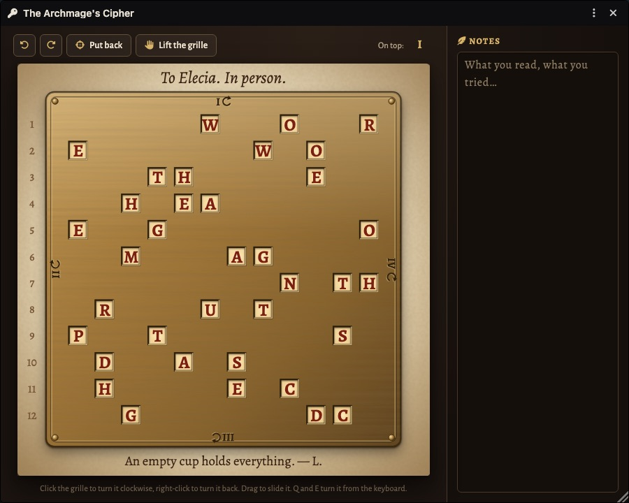
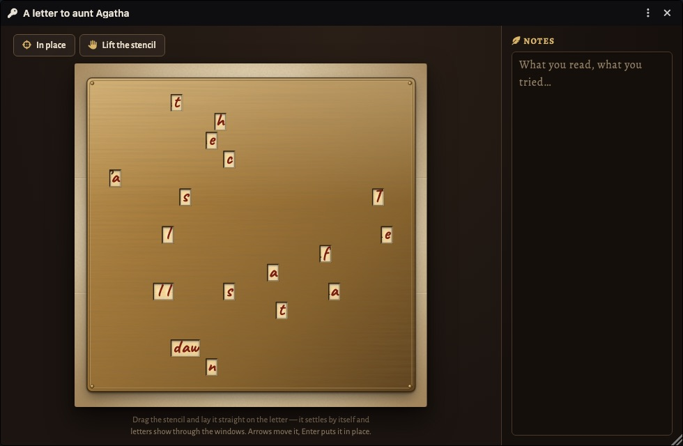
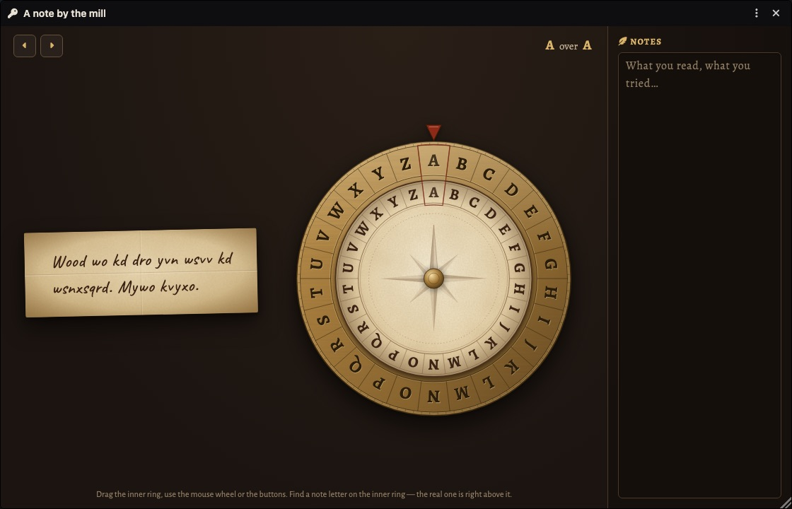
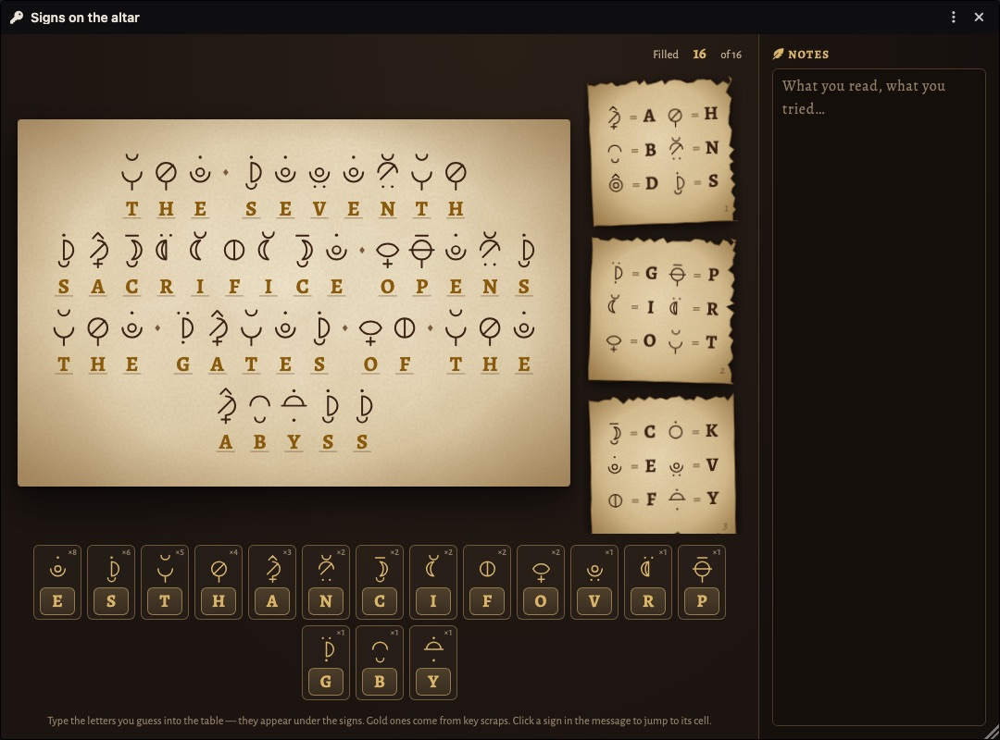
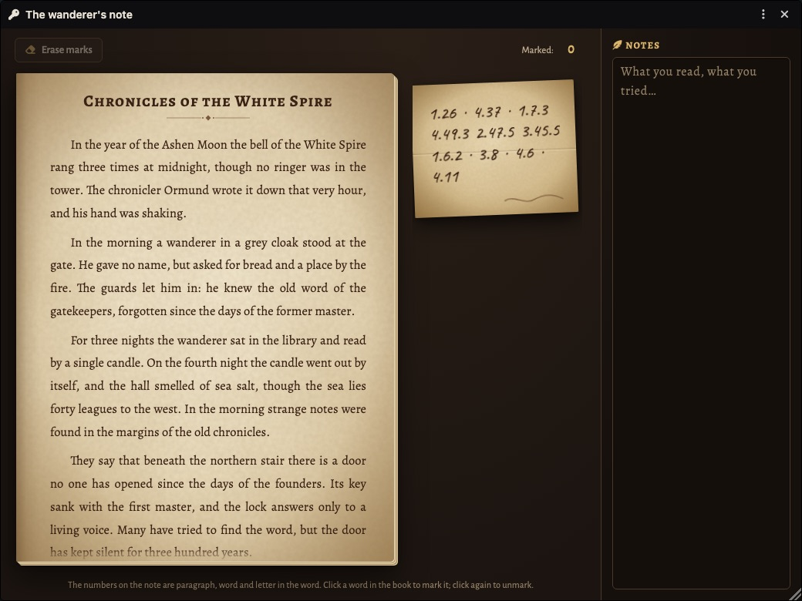
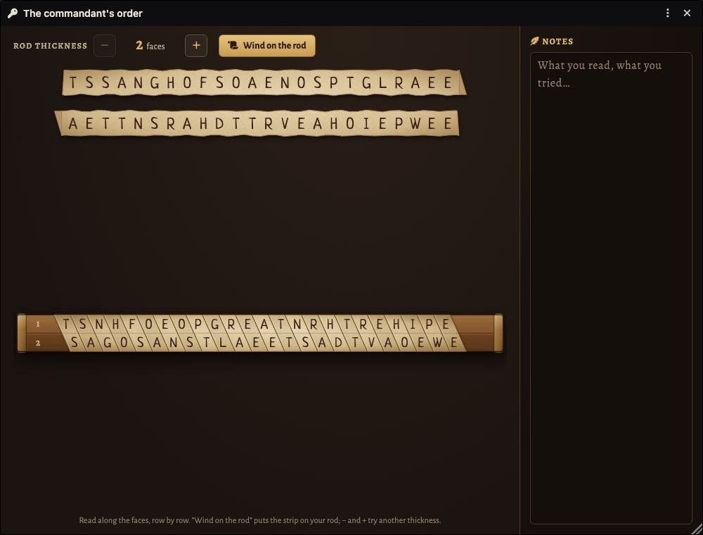
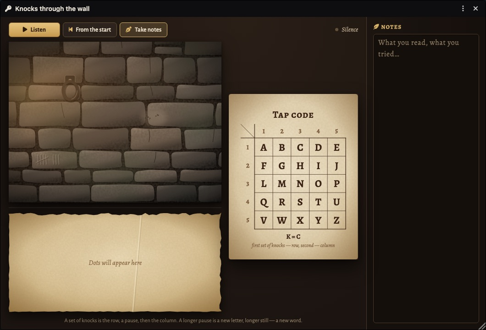
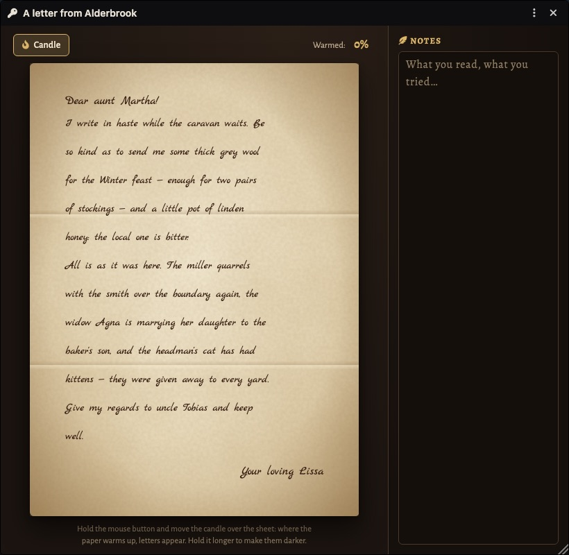
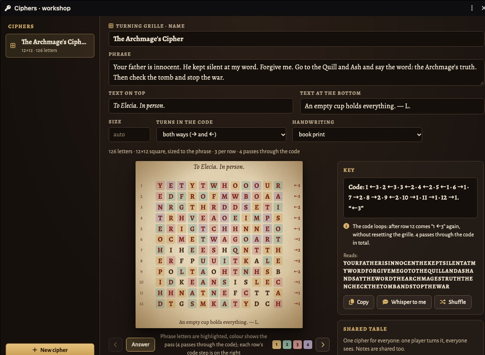
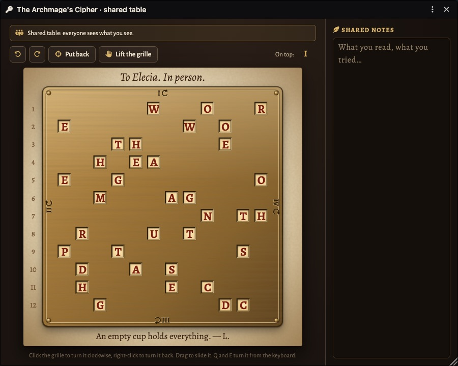

# Тайнопись · Ciphers & Puzzles

[Русский](README.md) · **English**

Ciphers and puzzles for Foundry VTT. The GM writes a text and the module turns it into props:
letters, brass plates, disks, strips, notes. Players hold them and solve them on their own,
one by one or all together at a shared table.

<p align="center">
  
</p>

## Installation

In Foundry: **Add-on Modules → Install Module**, paste the manifest URL at the bottom of the window:

```
https://github.com/klimenkoyg/foundry-cipher/releases/latest/download/module.json
```

Requires Foundry VTT **v13** or newer. Any game system.

## Eight ciphers

| | Cipher | What the players get | How they solve it |
|---|---|---|---|
|  | **Turning grille** | a letter with a grid of letters and a brass grille with windows | lay the grille on the letter and turn it by the code; the phrase shows through the windows |
|  | **Letter with a secret** (Cardan grille) | an ordinary letter and a stencil with slots | lay the stencil straight, and the secret phrase shows through among the letter's words |
|  | **Cipher disk** | a note in gibberish and a two-ring disk | turn the inner ring until the note becomes words; the key “A over K” is hidden in the world |
|  | **Secret alphabet** | a message in made-up signs and scraps of the key | fill letters into the sign table; the GM hands out the key scraps along the adventure |
|  | **Book cipher** | a note of numbers and a book | count paragraph, word and letter in the book; first they have to work out which book is the key |
|  | **Scytale** | a strip of jumbled letters and a rod | wind the strip on a rod of the right thickness; the text lines up along the faces |
|  | **Wall knocks** | knocking through the wall and a grid | listen to the series of knocks (row, column) and read them off the grid; for a dungeon scene |
|  | **Invisible ink** | an ordinary letter | move a candle over the sheet; where the paper warms up, hidden lines appear between the lines |

Phrases can be in Russian or in English: the module picks the alphabet from the text, and the disk,
the tap-code grid and the filler letters follow it.

## How it works

1. The GM clicks the key button in the token controls on the left. The **workshop** opens.
2. **“New cipher”** — pick a kind and fill in the fields. The cipher is built as you type;
   the preview shows the answer.
3. **“Key”** — what the GM knows: the grille code, the disk key, the note's numbers, and what
   it reads. **“Copy”** and **“Whisper to me”** both give the whole key.
4. **“Hand to players”** — every cipher has parts, and each player can be given their own:
   the letter to one, the grille to another, key scraps to a third. The player's window opens
   at once with what they were given. Clicking again takes the part back. If the cipher changed
   after it was handed out, an **“Update”** button appears next to the player.
5. **“Shared table”** — one cipher for everyone: someone turns, everyone sees, notes are shared.
   When putting the cipher on the table, the GM picks what to lay out (everything, only the letter,
   only the grille, some key scraps…) and who sits at the table; the rest can be added later.
   Players' changes go through the GM, so the GM must be in the game.
6. **“Images”** — the **“To journal”** button: all the cipher's images as a new journal entry,
   plus a key page only the GM can see. The images are light WebP, 1600 px and 20–180 KB, so players
   don't wait for them to load. Show them to players from the journal, with Foundry's own tools.

<table>
  <tr>
    <td width="50%" valign="top"><br><sub><b>Workshop</b> — fields, preview with the answer, key, shared table, handing out</sub></td>
    <td width="50%" valign="top"><br><sub><b>Shared table</b> — everyone sees the same grille</sub></td>
  </tr>
</table>

### Handwriting

Text on the props is handwritten or printed. Each cipher has its own default hand, and you can
change it in the workshop:
- **book print** — Alegreya;
- **scribe, quill** — Marck Script;
- **hasty note** — Caveat;
- **hand-printed** — Neucha;
- **old charter hand** — Kurale.

The invisible-ink letter is written by a scribe, notes in a hasty hand, the scytale strip
hand-printed. The fonts ship with the module and are embedded into the images.

### More on the turning grille

- The GM's code: `Code: 1 →2 · 2 ←1 · 3 →3 · … · 12 →1. “→2”`. The number is the letter's row,
  the arrow is which way to turn the grille (→ clockwise, ← counter-clockwise), the digit is how many
  quarter turns. Turns count from the “I on top” position. The quoted “→2” at the end is the first
  step again: after the last row the code loops.
- The letter is always square. If the “Size” field is empty, the smallest square that fits the phrase
  is used: 124 letters — 12×12, 29 letters — 6×6, 350 letters — 19×19. You can enter your own size,
  from 4 to 30.
- A phrase is usually read in several passes. Reaching the last row, start the code again without
  putting the grille back. The whole code turns it by an odd number of quarters, so every pass opens
  new cells. Four passes read the whole letter.
- With a generous size, a short phrase fits in one pass. Every row has almost as many windows as
  phrase letters in any position, so the number of lit cells does not give the right turn away.
- For the player: **click** the grille to turn it clockwise, **right-click** to turn it back;
  **Q** and **E** on the keyboard; the grille can be dragged, and dropped near its place it snaps
  straight.

## For macros

```js
const ciphers = game.modules.get("ssl_ciphers").api;
ciphers.openWorkshop();       // the GM's workshop
ciphers.kinds();              // cipher kinds
ciphers.puzzles();            // the world's ciphers (with answers for the GM)
ciphers.code(puzzleId);       // the GM's key: { line, notes, reads }
ciphers.open(puzzleId);       // the cipher window: for the GM, as players will see it
ciphers.openTable(puzzleId);  // the shared table window
```

## Development

```bash
npm test          # cipher cores: generation, decoding, edge cases
npm run check     # syntax, translations (incl. kind key families), templates, manifest files
npm run build     # dist/module.zip and dist/module.json
```

- `scripts/core/` — cipher cores with no Foundry dependencies, covered by tests.
- `scripts/foundry/kinds/` — cipher kinds: fields, drawings, player window, images.
  How a kind is built — see the header of `kinds/index.mjs`.
- `scripts/foundry/` — the framework: workshop, cipher window, handing out, shared table, images, handwriting.
- `lang/ru.json`, `lang/en.json` — shared strings; `lang/<language>/<kind>.json` — strings of a kind.
  `styles/kinds/<kind>.css` — styles of a kind.
- `dev/harness/` — a test bench that mocks Foundry: the real module code in a plain browser.
  Run `python3 -m http.server 8766 --bind 127.0.0.1`, then open `http://127.0.0.1:8766/dev/harness/`
  (`?lang=en` for English). `?hostile=1` adds Foundry-like “hostile” styles (and Font Awesome
  in a layer, as Foundry has it); `__ciphers.audit()` in the console finds clipped buttons,
  overlapping lines and icons without their font in all the module's windows.
- `scripts-dev/shot.sh` — a headless Chrome screenshot of the bench:
  `scripts-dev/shot.sh player out.png 1440 900 "&kind=disk&lang=en"` (scenes `workshop`, `player`, `table`, `export`).

## License

Free to use and to share unmodified; modifying, building upon and selling are not allowed.
The full text is in [LICENSE](LICENSE). The Alegreya, Marck Script, Caveat, Neucha and Kurale fonts are
under the SIL Open Font License (see `fonts/OFL.txt`, `fonts/OFL-handwriting.txt`).
