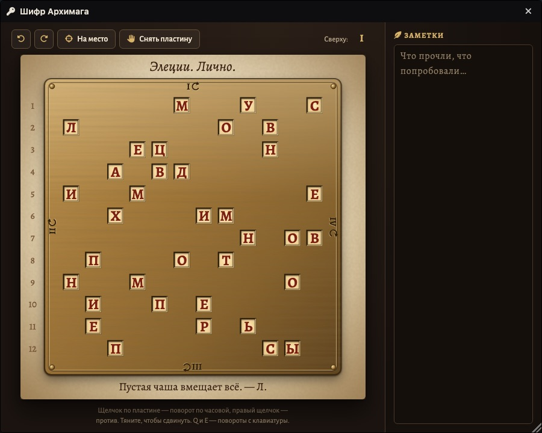
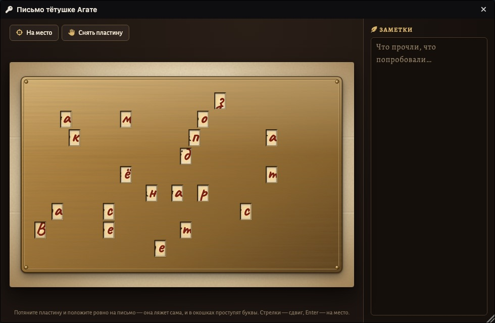
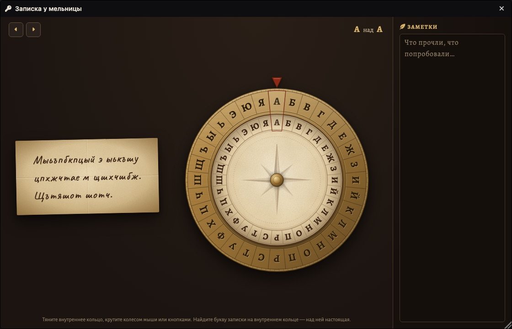
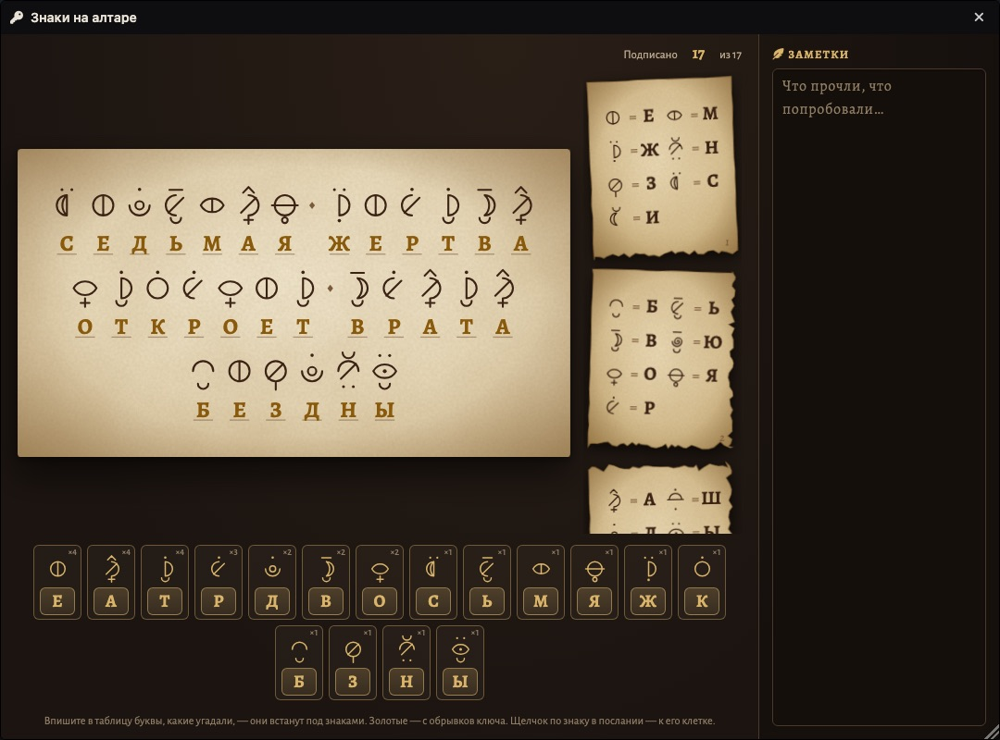
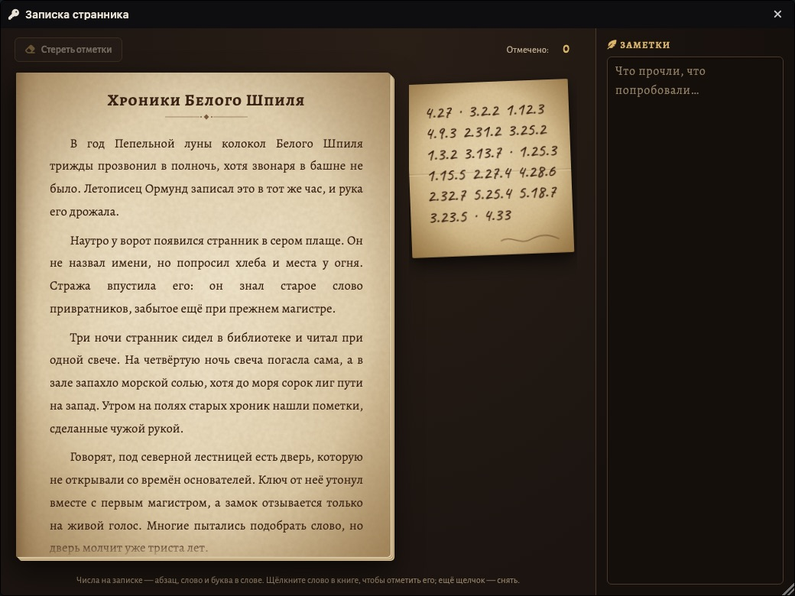
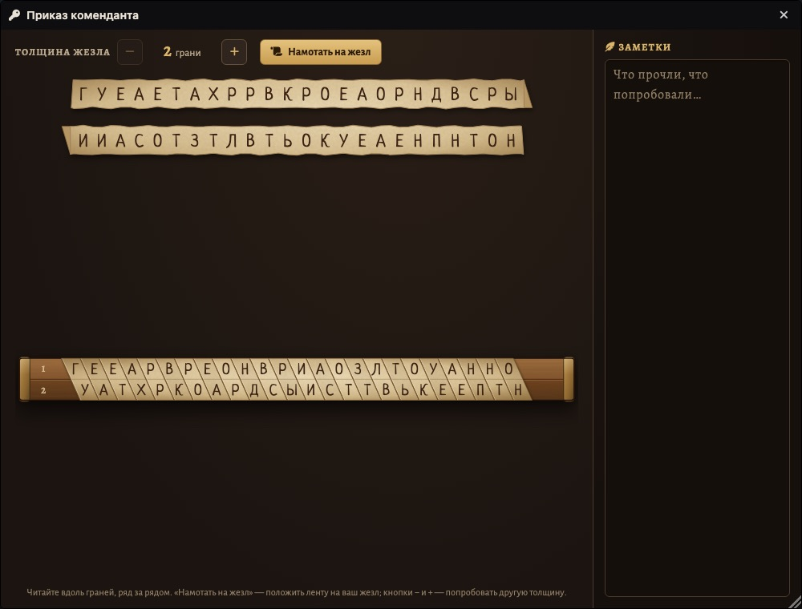
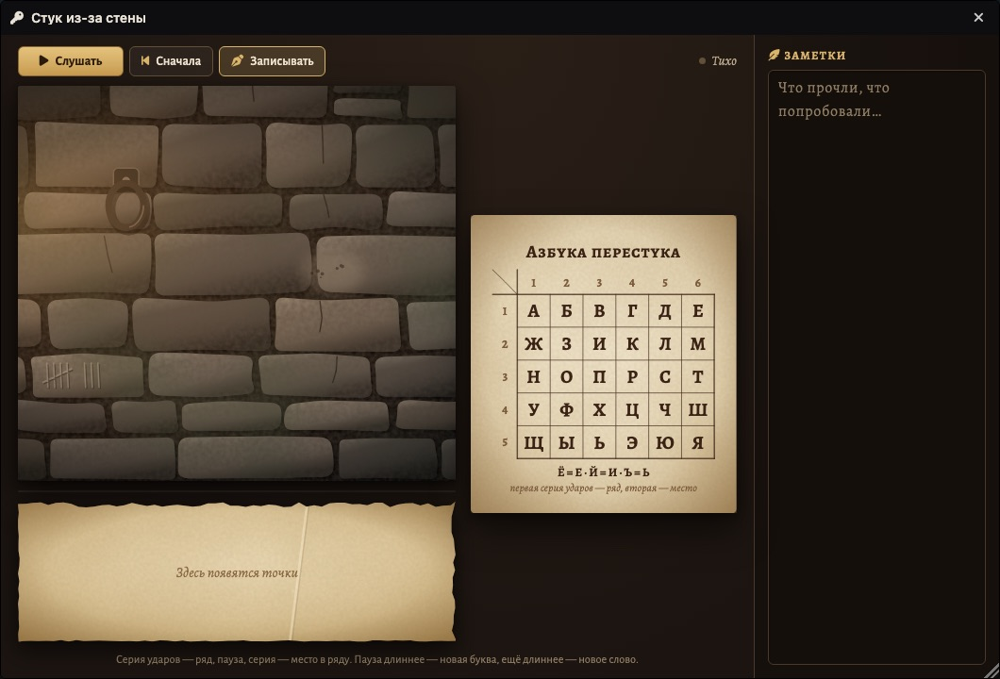
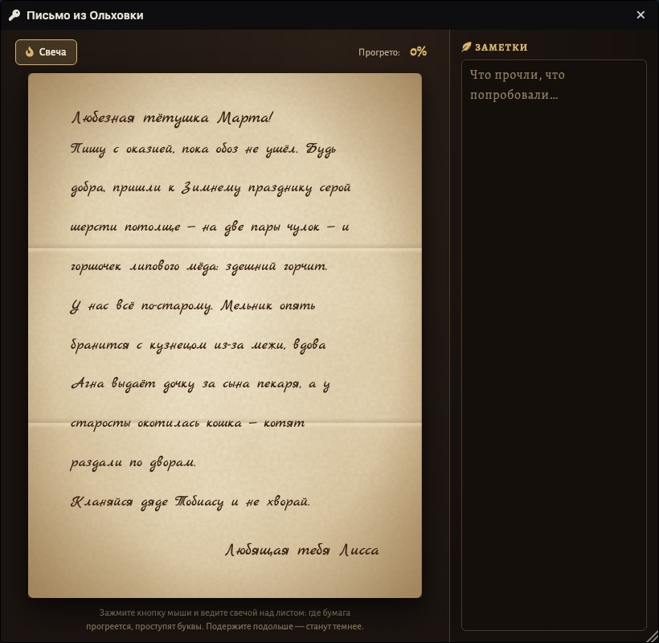
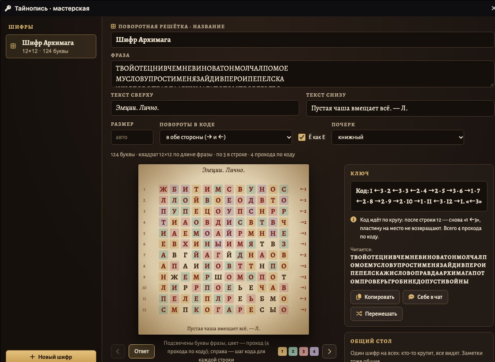
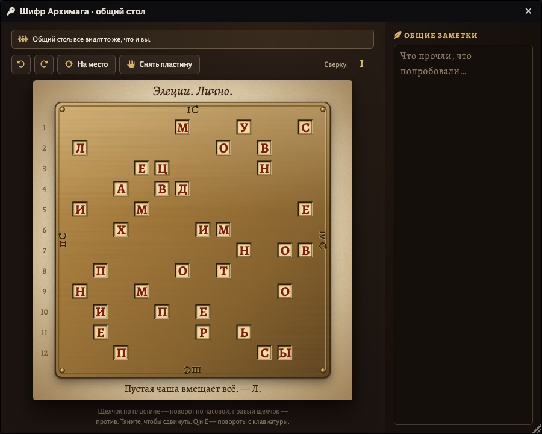

# Тайнопись · Ciphers & Puzzles

**Русский** · [English](README.en.md)

Шифры и головоломки для Foundry VTT. Ведущий пишет текст, а модуль собирает из него реквизит:
письма, пластины, диски, ленты, записки. Игроки держат его в руках и разгадывают сами,
поодиночке или все вместе за общим столом.

<p align="center">
  
</p>

## Установка

В Foundry: **Модули → Установить модуль**, внизу окна вставить адрес манифеста:

```
https://github.com/klimenkoyg/foundry-cipher/releases/latest/download/module.json
```

Нужен Foundry VTT **v13** или новее. Система — любая.

## Восемь шифров

| | Шифр | Что получают игроки | Как разгадывают |
|---|---|---|---|
|  | **Поворотная решётка** | письмо с сеткой букв и латунную пластину с окошками | кладут пластину на письмо и крутят её по коду; в окошках проступает фраза |
|  | **Письмо с секретом** (трафарет Кардано) | обычное письмо и пластину с прорезями | кладут пластину ровно, и из букв письма проступает тайная фраза |
|  | **Шифровальный диск** | записку абракадаброй и диск из двух колец | крутят внутреннее кольцо, пока записка не станет словами; ключ «А над К» прячется в мире |
|  | **Тайный алфавит** | послание выдуманными знаками и обрывки ключа | подставляют буквы в таблицу знаков; обрывки ведущий раздаёт по ходу приключения |
|  | **Книжный шифр** | записку из чисел и книгу | считают абзац, слово и букву в книге; сначала надо понять, какая книга — ключ |
|  | **Скитала** | ленту с буквами вперемешку и жезл | наматывают ленту на жезл нужной толщины; вдоль граней складывается текст |
|  | **Перестук** | стук из-за стены и таблицу | слушают серии ударов (ряд, место) и переводят по таблице; для сцены в темнице |
|  | **Невидимые чернила** | обычное письмо | водят свечой над листом; где бумага прогрелась, между строк проступает скрытое |

Фразы — на русском или английском: модуль сам выбирает алфавит по тексту, а за ним — диск,
таблицу перестука и буквы-заполнители.

## Как это работает

1. Ведущий нажимает кнопку с ключом на панели токенов слева. Откроется **мастерская**.
2. **«Новый шифр»** — выбрать вид и заполнить поля. Шифр собирается сразу, пока вы печатаете.
   В предпросмотре виден ответ.
3. **«Ключ»** — то, что знает ведущий: код решётки, ключ диска, числа записки и что читается.
   «Копировать» и «Себе в чат» дают ключ целиком.
4. **«Игрокам в руки»** — у каждого шифра есть части, их можно выдать каждому игроку отдельно:
   письмо одному, пластину другому, обрывки ключа третьему. У игрока сразу откроется окно с тем,
   что ему дали. Повторное нажатие забирает часть. Если шифр поменяли после выдачи, рядом
   с игроком появится кнопка **«Обновить»**.
5. **«Общий стол»** — один шифр на всех: кто-то крутит, все видят, заметки общие. Выкладывая
   шифр, ведущий выбирает, что положить (всё, только письмо, только пластину, часть обрывков ключа…)
   и кто за столом; остальное докладывается потом. Изменения игроков проходят через ведущего,
   поэтому ведущий должен быть в игре.
6. **«Картинки»** — кнопка «В журнал»: все картинки шифра новой записью в журнале и страница
   с ключом, которую видит только ведущий. Картинки — лёгкий WebP 1600 px, 20–180 КБ, игроки
   не ждут загрузки. Показать их игрокам можно из журнала, средствами самого Foundry.

<table>
  <tr>
    <td width="50%" valign="top"><br><sub><b>Мастерская</b> — поля, предпросмотр с ответом, ключ, общий стол, выдача</sub></td>
    <td width="50%" valign="top"><br><sub><b>Общий стол</b> — все видят одну и ту же пластину</sub></td>
  </tr>
</table>

### Почерки

Текст на реквизите пишется от руки или печатается. У каждого шифра свой почерк по умолчанию,
в мастерской его можно сменить:
- **книжный** — Alegreya;
- **писарь, пером** — Marck Script;
- **записка, наспех** — Caveat;
- **печатными от руки** — Neucha;
- **устав, по-старинному** — Kurale.

Письмо с невидимыми чернилами пишет писарь, записки — наспех, ленту скиталы — печатными.
Шрифты лежат внутри модуля, в картинки они встраиваются.

### Поворотная решётка подробнее

- Код для ведущего: `Код: 1 →2 · 2 ←1 · 3 →3 · … · 12 →1. «→2»`. Номер — строка письма,
  стрелка — куда повернуть пластину (→ по часовой, ← против), цифра — на сколько четвертей.
  Повороты отсчитываются от положения «I вверху». «→2» в кавычках в конце — первый шаг ещё раз:
  после последней строки код идёт по кругу.
- Письмо всегда квадратное. Если поле «Размер» пустое, берётся наименьший квадрат, в который
  фраза помещается: 124 буквы — 12×12, 29 букв — 6×6, 350 букв — 19×19. Можно вписать свой
  размер, от 4 до 30.
- Обычно фраза читается в несколько проходов. Дойдя до последней строки, код начинают сначала
  и пластину на место не возвращают. Весь код поворачивает её на нечётное число четвертей,
  поэтому каждый проход открывает новые клетки. Четыре прохода читают всё письмо.
- Если задать размер с запасом, короткая фраза уложится за один проход. Окошек в каждой строке
  в любом положении почти столько же, сколько букв фразы, так что по числу огоньков не угадать
  нужный поворот.
- У игрока: **щелчок** по пластине — поворот по часовой, **правый щелчок** — против;
  **Q** и **E** с клавиатуры; пластину можно тянуть, отпущенная у места, она ложится ровно.

## Для макросов

```js
const ciphers = game.modules.get("ssl_ciphers").api;
ciphers.openWorkshop();       // мастерская ведущего
ciphers.kinds();              // виды шифров
ciphers.puzzles();            // шифры мира (у ведущего — с ответами)
ciphers.code(puzzleId);       // ключ для ведущего: { line, notes, reads }
ciphers.open(puzzleId);       // окно шифра: у ведущего — как его увидят игроки
ciphers.openTable(puzzleId);  // окно общего стола
```

## Разработка

```bash
npm test          # ядра шифров: генерация, расшифровка, крайние случаи
npm run check     # синтаксис, переводы (с семействами ключей видов), шаблоны, файлы манифеста
npm run build     # dist/module.zip и dist/module.json
```

- `scripts/core/` — ядра шифров без зависимостей от Foundry, проверяются тестами.
- `scripts/foundry/kinds/` — виды шифров: поля, рисунки, окно игрока, картинки.
  Как устроен вид — в шапке `kinds/index.mjs`.
- `scripts/foundry/` — каркас: мастерская, окно шифра, выдача, общий стол, картинки, почерки.
- `lang/ru.json`, `lang/en.json` — общие строки; `lang/<язык>/<вид>.json` — строки вида.
  `styles/kinds/<вид>.css` — стили вида.
- `dev/harness/` — стенд с имитацией Foundry: настоящий код модуля в обычном браузере.
  Запуск: `python3 -m http.server 8766 --bind 127.0.0.1`, затем `http://127.0.0.1:8766/dev/harness/`
  (`?lang=en` — по-английски, с английскими примерами).
  `?hostile=1` подключает «враждебные» стили, как у Foundry (и Font Awesome в слое, как у неё);
  `__ciphers.audit()` в консоли находит обрезанные кнопки, налезающие строки и значки без своего
  шрифта во всех окнах модуля.
- `scripts-dev/shot.sh` — снимок стенда безголовым Chrome:
  `scripts-dev/shot.sh player out.png 1440 900 "&kind=disk"` (сцены `workshop`, `player`, `table`, `export`).

## Лицензия

Пользоваться и распространять без изменений можно бесплатно; изменять, дорабатывать и продавать — нельзя.
Полный текст — в [LICENSE](LICENSE). Шрифты Alegreya, Marck Script, Caveat, Neucha и Kurale — SIL Open Font
License (см. `fonts/OFL.txt`, `fonts/OFL-handwriting.txt`).
